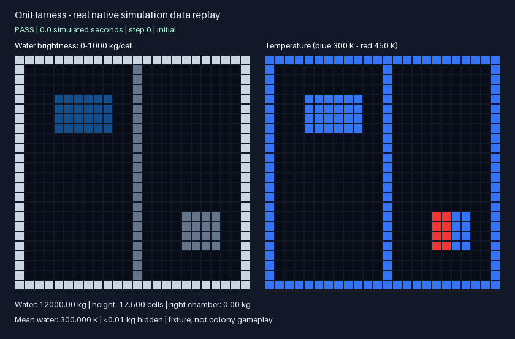

# OniHarness

**完全不启动游戏的《缺氧》Mod 测试工具。**

[English](README.md) · [能力边界](docs/capabilities.md) · [架构](docs/architecture.md)

OniHarness 用独立测试进程，直接调用本地安装游戏的真实模拟库。
不启动 ONI、Steam 或 Unity Player，不需要显卡、桌面和殖民地存档。

当前是 **0.1.0 预览版**。已验证的真实模拟后端支持 **Linux x64、游戏版本
744825**，并核对具体文件指纹。其他版本会明确报不支持。

现在可以测：气体质量守恒、液体下落、固体热交换、自定义材料参数、单格修改、
加热，以及脱离游戏运行的 C# Mod 逻辑。也能执行一部分不依赖 Unity 的真实游戏
C# 方法，或单独检查游戏方法是否存在。

尚不能验证完整读档、复制人 AI、建筑生命周期、UI 和 Harmony 补丁运行。
默认材料是测试输入，不是游戏完整数据库；当前关闭相变、疾病和辐射。

## 开始使用

需要 .NET SDK 10。框架自测无需安装游戏；真实模拟测试需要本地游戏文件。

```sh
git clone https://github.com/LIghtJUNction/OniHarness.git
cd OniHarness
dotnet build OniHarness.slnx -c Release
dotnet run --project tests/OniHarness.Tests -c Release --no-build

export ONIHARNESS_GAME_PATH="$HOME/.local/share/Steam/steamapps/common/OxygenNotIncluded"
dotnet run --project src/OniHarness.Cli -c Release --no-build -- doctor
dotnet run --project src/OniHarness.Cli -c Release --no-build -- \
  test examples/scenarios --repeat 3 --report artifacts/native.json
dotnet run --project src/OniHarness.Cli -c Release --no-build -- \
  test --assembly examples/ModTests/bin/Release/net10.0/ModTests.dll
```

也可以从 [Release](https://github.com/LIghtJUNction/OniHarness/releases) 下载 CLI 和
Core 包。具体安装、JSON 场景格式与 C# 用例写法见 [README](README.md)。

每个用例、每次重复都启动新的测试进程。框架等待一帧处理完成后才推进下一帧；
超时会终止测试进程树。失败、崩溃、不支持、没有选中任何测试都不会算通过。
重复执行会比较真实模拟场景的最终状态指纹。

测试结果明确标出证据类型：真实原生模拟、独立 C# 宿主、静态元数据。
这些结果不等于完整游戏内验收，也不能用来声称游戏 FPS 提升。

```sh
python3 scripts/verify.py
python3 scripts/verify.py --game-path /path/to/OxygenNotIncluded
```

第一条运行公开 CI 同样的框架验证；第二条额外运行真实游戏库测试。
用自己的 runner 提供本地游戏安装，公共 CI 不需要、也不会下载游戏文件。

## 配套技能与连续实验

仓库内附带 [oni-harness 技能](.agents/skills/oni-harness/SKILL.md)。技能和下述实验
在 v0.1.0 发布后加入源码仓库，使用当前源码即可运行：

```sh
python3 scripts/physics_playground.py --game-path /path/to/OxygenNotIncluded \
  --repeat 2 --output artifacts/physics-playground
```

实验会观察水落入槽底，再移除三个隔板格；观察到足够的水流入右槽后，给一个实际
水格加热。操作以读回的状态为依据，等待超限就停止，不继续发出后续操作。

打开输出目录里的 `index.html` 可以播放和拖动回放，查看每格质量、温度、操作与
检查结果。`trace.json` 保留真实采样和材料参数，`summary.json` 比较重复运行结果。
每次运行使用新目录，避免失败后读到上次留下的状态。

环境已有 Pillow 时可追加 `--gif`，生成 GIF 和四阶段概览图。默认 HTML 无需额外
Python 依赖。回放来自物理测试数据，不是游戏画面，也不代表已经实现复制人游玩。



本轮[实测记录](docs/verification/playground.json)附带文件指纹、检查结果和观察预算不足
时的拒绝结果。12,000 kg 水的最终变化约 0.22 kg，位于预先设定的 0.5 kg 容差内。

测试代码拥有普通本地程序权限。子进程隔离用于处理超时和崩溃，不是权限沙箱。

OniHarness 是独立 Git 项目，通过 submodule 接入 OniMods，其他作者可以单独使用。
原创新代码沿用 **AUL 1.0-draft.1**；它是自定义许可证，尚未获 OSI 批准。
游戏文件和第三方软件保持各自条款，不随项目分发。
