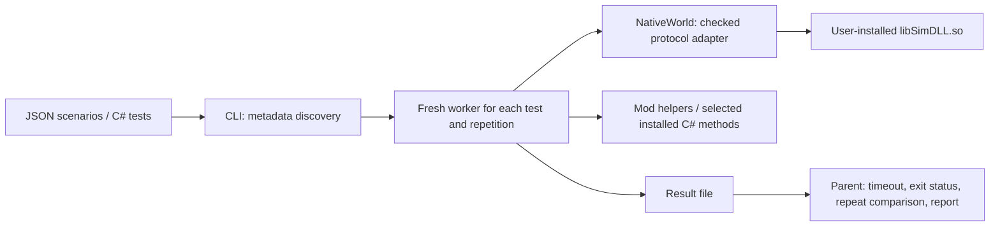

# Architecture

This page describes the original game-free worker/native adapter architecture.
The optional [real-game workflow](runtime.md) is separate: Steam starts ONI,
default batch/no-graphics arguments avoid a window and graphics device, an
in-game companion verifies that mode and guards bounded runs, and a loopback MCP client records the
same paused virtual-file maps for the agent and optional spectator.

The goal is quick, reproducible tests without starting an ONI or Unity Player
process. The harness is a C# SDK and .NET CLI; it does not rebuild Unity or model
ONI physics in a substitute engine.

The parent reads test attributes as PE metadata. It never loads the test assembly
for discovery. Workers communicate results through private temporary files;
native stdout cannot corrupt the result protocol. Both output pipes are drained
with a 16 KiB cap each. The parent kills the worker process tree on timeout or
cancellation and reaps it before returning. Tests are trusted local code.

The native adapter hashes both the installed simulation library and managed
assembly before calling native code. Unsupported pairs fail closed. Initial
fixture cells, disease-free cells and empty backwalls are serialized into a
headless world. The adapter sends one frame request, then polls for exactly one
completed frame before sending another. A polling sleep is a wait, not evidence
that a frame has completed. Snapshot arrays are copied into managed memory.

Each process may initialize only one native world, used on its creating thread.
Fresh processes isolate native globals and repeated runs. A hung native call
cannot be reliably cancelled in-process, hence the outer process timeout.

Managed tests run in .NET 10. A dedicated assembly resolver shares the harness
contract and uses the host's framework assemblies, avoiding Unity's bundled
mscorlib. Game assemblies and test dependencies are otherwise read from their
local directories. No Unity methods are silently replaced. Reflection execution
establishes behavior in this host, not Mono/Unity compatibility.

The original design considered both a shared collection of game API stubs and a
host using real game libraries. The real-library host was selected because a
test must be able to detect changes in the actual solver. Portable helper tests
remain useful, with a separate evidence label.

Full lifecycle hosting and Harmony execution need additional runtime work. They
are not inferred from a successful simulation test or a static method contract.
New adapters require local verification, a reproducible receipt and an explicit
capability update; do not simply replace the accepted hashes after a game update.
