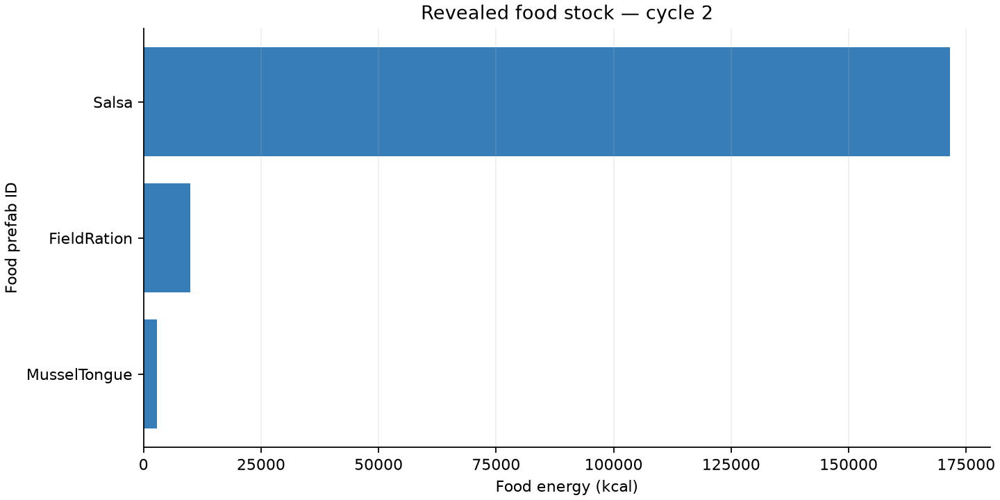
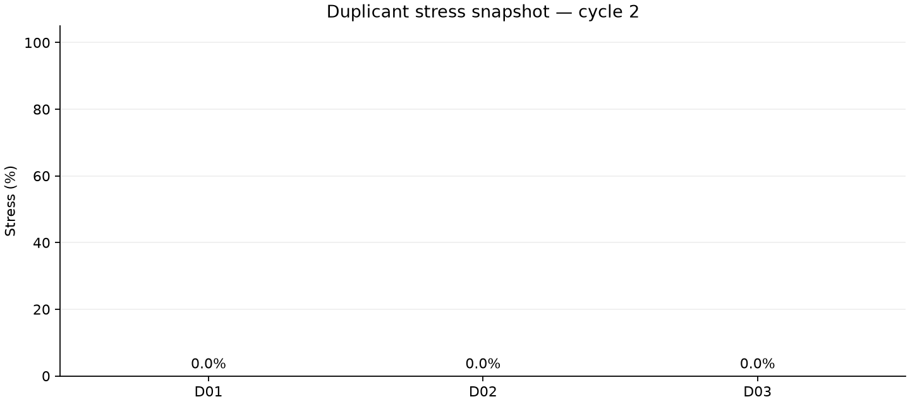
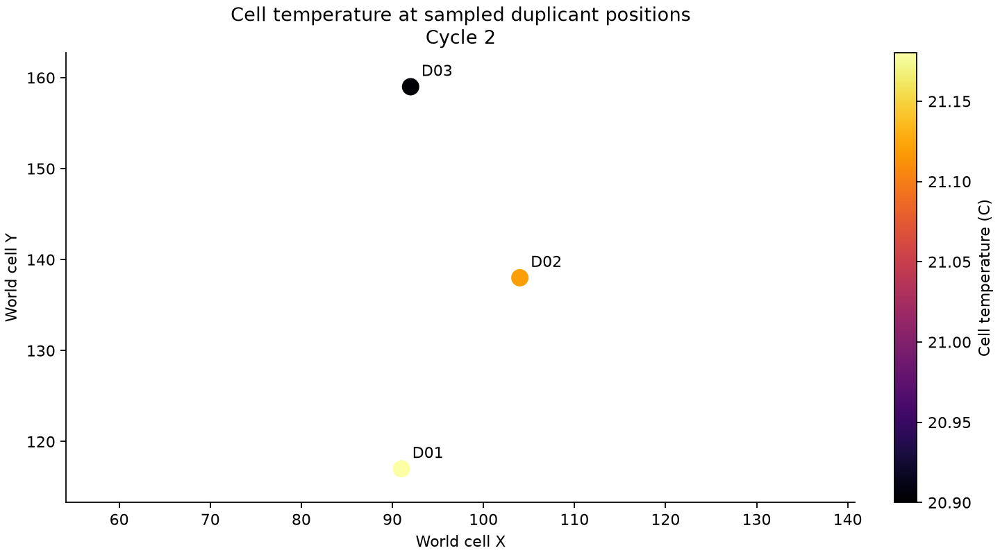

# Analyze Oxygen Not Included Like a Data Scientist

Locally verified on Linux with ONI build 744825, Python 3.15.0 and a paused
three-duplicant test-save copy. The game used normal OpenGL graphics, not
headless mode. A Python/Jupyter introduction based on this walkthrough is now
[published on the Klei forum](https://kleiforums.com/forums/topic/173714-tool-oniharness-%E2%80%94-repeatable-tests-for-oni-mods/#comment-1881682), including a preview wheel, matching source archive, notebook, and measured charts.

OniHarness can connect a Python notebook to a running Oxygen Not Included
colony. You can display the real game viewport beside pandas tables and
Matplotlib charts, then refresh the view without leaving Jupyter.

The [complete English notebook](../../examples/python/analyze_oni.ipynb) covers
the following workflow:

1. Verify the connection and pause the simulation.
2. Display a fresh game-rendered frame in the notebook.
3. Collect colony, revealed food, and duplicant observations.
4. Check returned counts and energy totals before plotting food stocks.
5. Plot duplicant stress, keeping missing values distinct from zero.
6. Inspect measured cell temperatures and elements at duplicant positions.
7. Refresh one live output and export reviewed CSV files and provenance.

## Install and open the notebook

You need your own ONI installation, OniMcp, uv, and Python 3.15. Start the game
through Steam and load a disposable save with normal graphics enabled.
The Python kernel and OniMcp must run on the same computer.

```sh
git clone https://github.com/LIghtJUNction/OniHarness.git
cd OniHarness
uv sync --python 3.15 --extra notebook --locked
uv run --python 3.15 --extra notebook python -m ipykernel install --user \
  --name oniharness-315 --display-name "OniHarness (Python 3.15)"
uv run --python 3.15 --extra notebook jupyter lab examples/python/analyze_oni.ipynb
```

Select **OniHarness (Python 3.15)** and run the cells in order. The default local
MCP address is `http://127.0.0.1:8788/mcp/`. If authentication is enabled, set
`ONIHARNESS_MCP_TOKEN` in the kernel environment; do not paste it into a cell.

## Put the actual game view in a cell

```python
from oniharness import Game

game = Game()
frame = game.frame()
frame
```

This is a real Unity screenshot. The library requests a unique PNG and waits
until the file is complete. Its bytes are embedded in notebook output, so
reopening a saved notebook still shows the captured frame.

```python
frame.save("colony.png")
last_frame = game.watch(frames=3, interval=0.5)
```

`watch` updates one display three times, then stops. It keeps the simulation
paused; it does not resume the colony or promise video frame rates. Capture
time is added to the requested interval. A saved notebook is a snapshot, and
does not start a background stream when reopened.

Headless ONI with a Null graphics device cannot produce game art. Numeric
plots and native fixture replays are separate from rendered game frames.

## Use decorators to keep analysis paused

```python
import pandas as pd

@game.paused
def food_stock():
    data = game.read("/active/resources/food.oni")
    assert data["returned"] == data["foodTypes"], "The food result is truncated."
    table = pd.DataFrame(data["foods"])
    return table[["prefabId", "totalCaloriesKcal", "totalMassKg"]]

food_stock()
```

The decorator verifies pause before and after the operation, including when
the function raises. Food energy is in kcal and mass is in kg. This stock
measurement includes revealed loose and stored food; it does not measure
production, consumption, or how many cycles the colony will survive.

The notebook checks the sum of per-food energy against the returned total,
allowing for the server's rounding. It also checks duplicant counts and stress
ranges. Unknown values are left missing, including the displayed maximum;
when every stress value is unknown, no stress chart is generated.

## Look locally as well as at totals

The notebook reads diagnostic environment samples at duplicant positions:
element ID, cell mass, and temperature. Its scatter plot marks only observed,
revealed positions. It does not interpolate a whole oxygen map from a few
points. Cell mass in kg is not pressure in pascals.

Duplicants receive temporary aliases such as D01 in the exported tables.
Private save paths, names, tokens, full logs, saves, and game binaries are not
part of the shared example.

## What the local run showed

The executed notebook captured a real game frame, three revealed food types,
all three duplicants, and three valid environment samples at cycle 2.
Revealed food totalled 184,348.1 kcal: 171,600 kcal of Salsa, 9,948.1 kcal
of FieldRation, and 2,800 kcal of MusselTongue. This is stock, not production.



The first run exposed an OniMcp defect: all native need values were unknown
because the reader used Unity component lookup for the game's amount collection.
After replacing that lookup with the game's `GetAmounts()` accessor and
restarting the same test-save copy, all six reported needs were known for all
three duplicants. All three stress values were measured as 0%. If your server
still returns unknown needs, update OniMcp; do not replace missing values with
zero in pandas.



The sampled cells measured 20.90–21.18 C and contained CarbonDioxide or
Methane. Three points do not establish colony-wide air quality. The companion
reported the same simulation time, 920.552124 seconds, before and after the
notebook observations. The colony remained paused. No gameplay step was
needed for this read-only notebook check.



The JupyterLab Run menu did not respond in the initial browser session. The
same notebook was executed from its working directory with:

```sh
uv run --python 3.15 --extra notebook jupyter nbconvert --to notebook \
  --execute analyze_oni.ipynb --inplace \
  --ExecutePreprocessor.kernel_name=oniharness-315 \
  --ExecutePreprocessor.timeout=120
```

Reload the JupyterLab tab after a command-line execution to display the saved
outputs. Keep the example source notebook free of private captured outputs.

## Measure change deliberately

Repeated observations of a paused colony are useful for inspecting current
state, but they do not establish growth rates or causal effects. For a time
comparison, collect another sample after a separately controlled, short game
step, and record both simulation time and receipt time.

Native mod tests use `Suite`, `@suite.scenario`, `@parametrize`, and
`@expect.mass_conserved`. Those run small isolated fixtures rather than the
live colony. C# developers can use the `OniHarness.Core` library and
`OniHarness.Cli` tool; see the [C# package example](../nuget.md).

OniHarness is an unofficial community project, not affiliated with Klei or
Unity. Original framework code uses AUL 1.0-draft.1, a custom license that is
not OSI-approved. ONI and dependencies retain their own terms.
